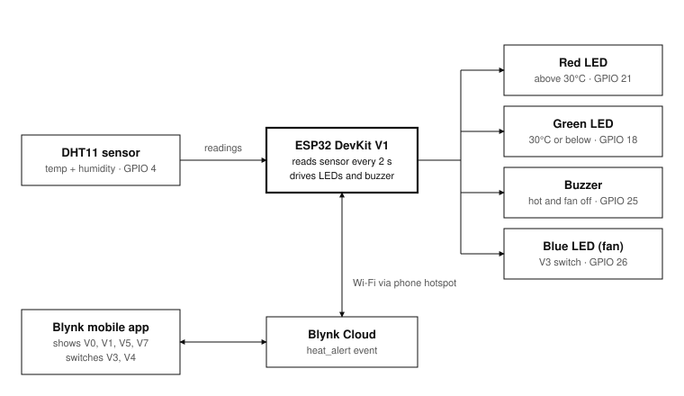
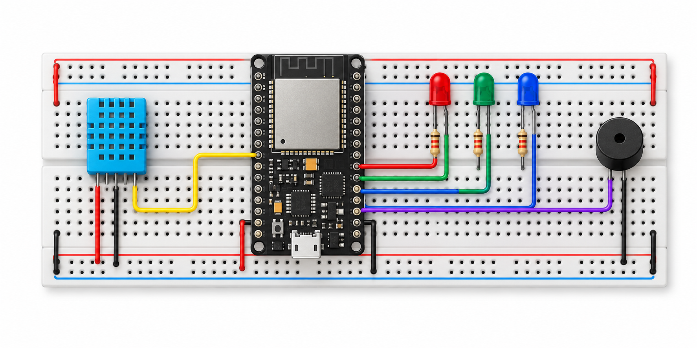
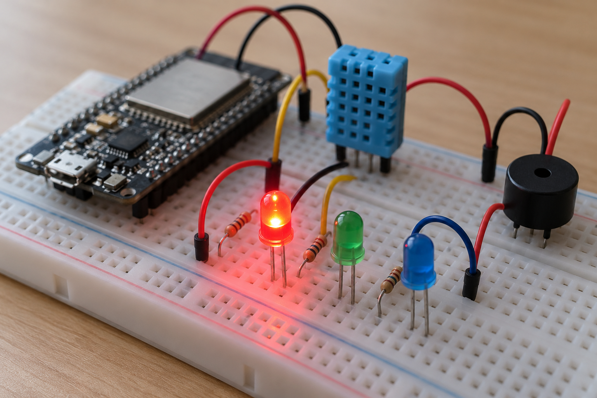
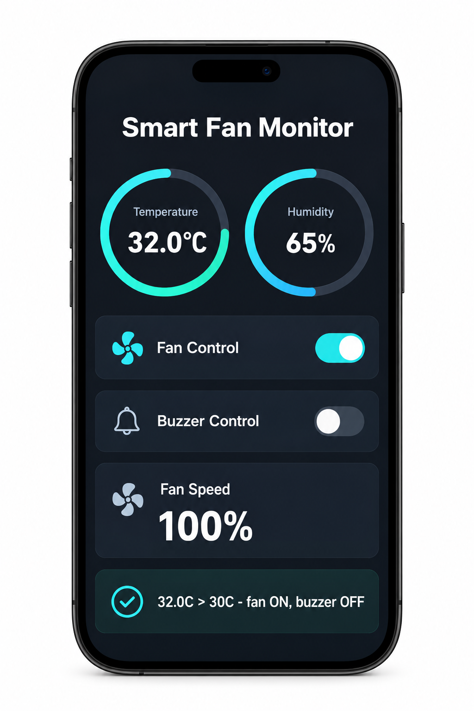

# Smart Fan Monitor

**IoT temperature monitoring and fan control with ESP32, DHT11 and Blynk.**

The ESP32 reads room temperature and humidity every 2 seconds. When the room goes above **30°C**, a red LED lights up, a buzzer beeps and the phone gets a Blynk push notification. Switching the fan on from the Blynk app silences the buzzer at once. In this prototype a blue LED stands in for the fan.



## Features

- Live temperature and humidity on the Blynk IoT dashboard
- Red/green LED shows hot (above 30°C) or normal (30°C or below)
- Intermittent buzzer alarm while it's hot and the fan is off
- `heat_alert` push notification each time the temperature crosses 30°C
- Fan on/off from the phone; turning the fan on stops the buzzer immediately
- Non-blocking code: keeps working offline and reconnects to Wi-Fi and Blynk by itself

## Hardware

| Component | Qty |
| --- | --- |
| ESP32 DevKit V1 (30-pin) | 1 |
| DHT11 temperature and humidity sensor | 1 |
| Active buzzer module | 1 |
| LEDs: red, green, blue (fan indicator) | 1 each |
| 220 Ω resistors | 3 |
| Breadboard and jumper wires | 1 set |

## Wiring

| Component | Pin | ESP32 |
| --- | --- | --- |
| DHT11 | DATA / VCC / GND | GPIO 4 / 3.3 V / GND |
| Active buzzer | + / − | GPIO 25 / GND |
| Red LED (via 220 Ω) | anode | GPIO 21 |
| Green LED (via 220 Ω) | anode | GPIO 18 |
| Blue LED, fan (via 220 Ω) | anode | GPIO 26 |
| All LEDs | cathode | GND |

## Blynk setup

Create a template called **Smart Fan Monitor** with these datastreams:

| Pin | Name | Type | Range | Widget |
| --- | --- | --- | --- | --- |
| V0 | Temperature | Double | °C | Gauge |
| V1 | Humidity | Double | % | Gauge |
| V3 | Fan Control | Integer | 0–1 | Switch |
| V4 | Buzzer Control | Integer | 0–1 | Switch (buzzer test) |
| V5 | Fan Speed | Integer | 0–100 % | Value display |
| V7 | Status | String | – | Label |

Add an event with the code `heat_alert` and turn on push notifications for it.

## How it behaves

| Condition | Red | Green | Buzzer | Fan (blue) |
| --- | --- | --- | --- | --- |
| Above 30°C, fan off | ON | OFF | Beeping | OFF |
| Above 30°C, fan on | ON | OFF | OFF | ON |
| 30°C or below | OFF | ON | OFF | as set in app |

The core rule in `applyOutputs()`:

```cpp
buzzerOn = !fanOn && (hot || buzzerSwitch);
```

## Getting started

1. Install the **Arduino IDE** and the **ESP32 board package (core 3.x)**.
2. From the Library Manager, install **Blynk** (by Volodymyr Shymanskyy), **DHT sensor library** (Adafruit) and **Adafruit Unified Sensor**.
3. Open `firmware/smart_fan_monitor/smart_fan_monitor.ino`.
4. Fill in your own values at the top:
   ```cpp
   #define BLYNK_TEMPLATE_ID   "YOUR_TEMPLATE_ID"
   #define BLYNK_AUTH_TOKEN    "YOUR_AUTH_TOKEN"
   char ssid[] = "YOUR_HOTSPOT_NAME";
   char pass[] = "YOUR_HOTSPOT_PASSWORD";
   ```
5. Select **ESP32 Dev Module**, upload, and open the Serial Monitor at **115200** baud.

The ESP32 only supports **2.4 GHz** Wi-Fi. Never commit your real Auth Token or Wi-Fi password.

## Repository layout

```
firmware/smart_fan_monitor/smart_fan_monitor.ino   Arduino sketch
docs/Smart_Fan_Monitor_Report.pdf                  Full project report
images/                                            Block diagram and illustrations
```

## Images

| Breadboard setup | Alarm state | Blynk dashboard |
| --- | --- | --- |
|  |  |  |

*These three images are AI-generated illustrations, not photos of the actual build.*

## Future scope

- Drive a real 5 V DC fan through a D4184 MOSFET module on GPIO 27
- PWM fan speed control reported on V5
- DHT22 or BME280 for better accuracy
- Hysteresis around 30°C, and a threshold slider in the app

## Team

- **Sammeti Venkata Pranay** ([@pranayyy81](https://github.com/pranayyy81))
- B. Mokshith Reddy
- R. Bala Aditya Kumar

B.Tech ECE, GITAM (Deemed to be University), Visakhapatnam
Course: 24EECE2031, Introduction to IoT and Its Applications

## License

[MIT](LICENSE)
